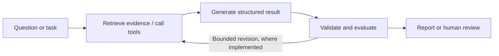

# Sprints Internships Projects

**LangChain & LangGraph portfolio by [Ahmed Hossam](https://github.com/AhmedxHossam)**

Nine projects exploring retrieval-augmented generation, structured model outputs, agent evaluation, checkpointed workflows, MCP tools, and human review. Built during Sprints training, with runnable source code and architecture documents.

## Start here

- **Explore an end-to-end capstone:** [CapitalTrust EGP Financial Analyst](langgraph/05-egp-financial-analyst/) combines RAG, an analyst/reviewer loop, MCP, audit records, and persistent human review.
- **Try a business assistant:** [NexusAgent](langchain/02-enterprise-rag-agent/) combines read-only SQL, policy retrieval, and conversational memory.
- **Inspect durable approval gates:** [AegisHealth](langgraph/04-medical-triage-workflow/) demonstrates escalation and final review over synthetic records.
- **Run a small example without model keys:** [Nile Insights](langgraph/02-persistent-research-assistant/) supports `--mock`; [Lumina Rescue](langgraph/03-agentic-rag-rescue/) supports `--mode demo`.

## LangChain projects

1. [LCEL Routing & Structured Reporting](langchain/01-lcel-routing/) — concurrent retrieval, intent routing, and separate Pydantic output contracts.
2. [NexusAgent: Enterprise RAG Assistant](langchain/02-enterprise-rag-agent/) — read-only SQL, FAISS policy retrieval, optional news, and hybrid conversation memory.
3. [Financial ReAct Agent](langchain/03-financial-react-agent/) — policy retrieval, arithmetic tools, bounded prompt memory, and JSON compliance reports.
4. [Agentic RAG Architecture](langchain/04-agentic-rag-architecture/) — query-log analysis, ingestion/retrieval design, fallback strategy, and observability planning. **Document project.**

## LangGraph projects

1. [Financial Report Evaluator–Optimizer](langgraph/01-financial-report-evaluator/) — rubric-driven report generation, bounded revision, and human fallback.
2. [Nile Insights Research Assistant](langgraph/02-persistent-research-assistant/) — search tools, thread isolation, and in-process checkpoint history.
3. [Lumina Rescue](langgraph/03-agentic-rag-rescue/) — retrieval, critique, query refinement, and deterministic termination.
4. [AegisHealth Medical Triage](langgraph/04-medical-triage-workflow/) — separate MCP records service, SQLite recovery, validated handoffs, and approval gates.
5. [CapitalTrust EGP Financial Analyst](langgraph/05-egp-financial-analyst/) — financial RAG, analyst/reviewer agents, audit records, MCP fixtures, and persistent human review. **Capstone.**



The diagram summarizes recurring patterns. Each project's documentation describes its actual graph and boundaries.

## Download and run one project

Open a project above and click **Download this project as ZIP**, or use the [individual downloads](downloads/README.md). Extract the archive, open its README, and follow its setup steps. Each archive includes that project's source, dependencies, example configuration, documentation, and tests where available.

To clone the complete portfolio:

```bash
git clone https://github.com/AhmedxHossam/Sprints-Internships-Projects.git
cd Sprints-Internships-Projects/langgraph/02-persistent-research-assistant
python -m venv .venv
# Windows PowerShell: .\.venv\Scripts\Activate.ps1
# macOS/Linux: source .venv/bin/activate
python -m pip install -r requirements.txt
python src/research_agent.py --mock
```

Use a separate virtual environment for each project. Their pinned dependency versions differ. Copy `.env.example` to a private `.env` when configuration is needed. API keys and installed environments are excluded from the portfolio.

## Project boundaries

Offline demos use clearly labeled fixtures or deterministic model doubles. Live modes require your own provider access and quota. Some projects intentionally use classic LangChain APIs to match their training briefs. The architecture proposal is a document deliverable rather than a runnable service.

Financial policies, FX values, and medical records are training examples. The financial analyst uses historical EGX data and synthetic FX; the triage and research prototypes have no clinical validation. Checkpoints in Nile Insights are in process; CapitalTrust and AegisHealth use SQLite for restart recovery. Each README explains the relevant limitations.

## Verification and maintenance

[Verification notes](docs/VERIFICATION.md) record local checks and their limits. GitHub Actions checks repository hygiene, Python syntax, notebook structure, local Markdown links, and download consistency on every push and pull request. It does not send live model requests.

Project ZIPs are generated from the source with `python tools/build_downloads.py`. After changing a project, rebuild its archive and run `python tools/check_repository.py` before committing.

## Attribution

Implementation and portfolio organization: Ahmed Hossam. Project scenarios and supplied training materials originate from Sprints coursework. This repository is a personal learning portfolio and is not an official Sprints product. Original reference implementations are identified in the relevant project documents. No blanket license is applied to supplied third-party course material.
