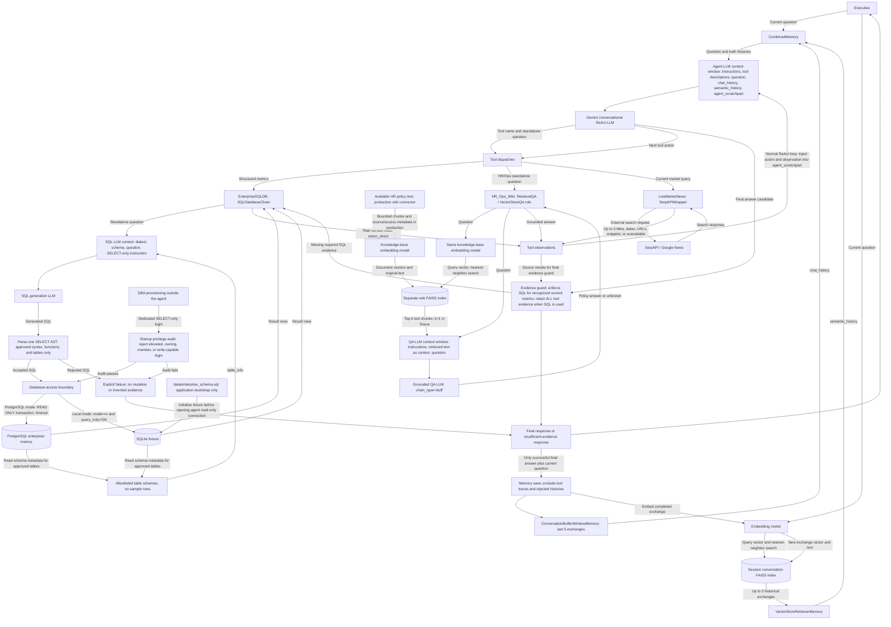

# NexusAgent Executive RAG Architecture

The three LLM context windows are distinct: the agent chooses tools and synthesizes
observations, the SQL chain receives only schema/question instructions, and RetrievalQA
receives retrieved wiki text through `{context}`. Wiki and news evidence return through
`agent_scratchpad`; remembered conversation uses `chat_history` and `semantic_history`.
The final evidence guard formats all source observations when SQL is used so a mixed
SQL/news/wiki question does not lose non-SQL evidence or replace database numbers.

The DBA role setup and fixture initialization run outside model-controlled tools. See
[postgres_readonly_role.sql](postgres_readonly_role.sql) for the dedicated-database
provisioning example. Startup verifies effective role privileges; each PostgreSQL
transaction also requests READ ONLY. SQL AST validation is an additional restriction,
not a replacement for database authorization. A rejected SQL statement raises an error;
the CLI reports that failure and does not save a successful conversation turn.

The history index and wiki index are separate. PostgreSQL and a hosted custom vector
database are production integration points; the local implementation uses seeded SQLite
and FAISS. The supplied wiki has one HR sentence, so k=1; production chunking, metadata
access filters, durable memory, and strict token-budget enforcement are deployment work.
Conversation FAISS is per executor, in process, and is not persisted across restarts.

In `--demo`, the same agent, memories, SQL chain, and wiki retriever execute with a
scripted model and deterministic local embeddings. The search tool explicitly reports
that live news is unavailable. No Gemini or SERP request is made in demo mode.
