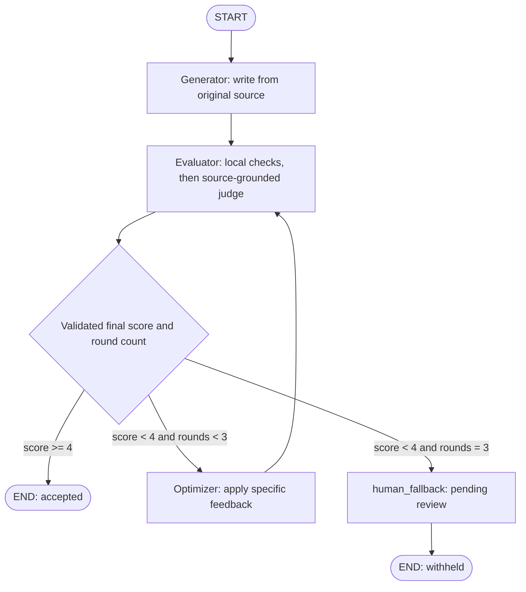

# Proposal: A Bounded Evaluator-Optimizer Workflow for Financial Reports

**To:** Engineering Director, NexusNode AI  
**Project:** Financial Report Generation Agent  
**Prepared by:** Engineering  
**Date:** 11 November 2026  
**Status:** Proposed architecture for staging validation

## Recommendation

Replace the current sequential report chain with a LangGraph evaluator-optimizer workflow. Require a source-grounded evaluation before automatic acceptance, return specific defects to an optimizer, and escalate unresolved reports after three evaluation rounds. This gives the Q3 feature an explicit, auditable quality gate while bounding additional model calls.

The requested decision is to adopt this architecture for staging validation. Production release should depend on measured accuracy, latency and cost against an independently reviewed test set. Automated evaluation reduces risk; it does not guarantee factual correctness.

## Findings from the supplied implementation

The supplied [current_sequential_chain.py](../src/current_sequential_chain.py) executes two LLM calls: extraction followed by report generation. Its extraction prompt explicitly asks the model to estimate missing revenue, operating margin and EPS using industry growth rates. Its report prompt then asks for a creative narrative that makes the company look good. The generator receives extracted metrics rather than the original notes, so an extraction error can become an apparently authoritative statement downstream.

The NovaTech example contains approximate revenue and growth, uncertainty about the notes, and no final EPS. A valid report must preserve those qualifications and disclose missing metrics. Lowering temperature alone would leave the instruction to invent missing information intact.

The separate Apex staging sample exhibits an impossible date, broken Markdown, an unexplained Q5, a numeric `NaN`, unsupported financial explanations and an inappropriate tone. No authoritative Apex source is supplied, so its numerical claims cannot be independently verified from this attachment. These examples establish useful regression cases, not a complete reference dataset.

## Architectural change

The current one-dimensional execution is:

`raw notes -> inferred metrics -> one-shot report -> client output`

There is no route from an identified defect back to the report writer. Sequential chains can contain validation, but the supplied chain has no acceptance gate or correction cycle.

The proposed graph is:

This implements the cyclical evaluation and revision pattern described in the [LangGraph workflow documentation](https://docs.langchain.com/oss/python/langgraph/workflows-agents#evaluator-optimizer). Nodes update shared state; conditional edges select the next step using a deterministic Python decision. See the [Graph API documentation](https://docs.langchain.com/oss/python/langgraph/graph-api#conditional-edges).

## Responsibilities and acceptance policy

1. **Generator:** Draft directly from the original source. Preserve approximate values, source uncertainty, units and periods. Label absent values as “not reported.” Use the required report sections and avoid speculative padding to reach a word target.
2. **Evaluator:** First validate nonblank content and required Markdown headings with Pydantic and explicit validators. If that fails, record actionable errors without paying for a judge call. Otherwise compare the draft with the same original source using the configured Gemini model and a structured three-criterion rubric. The adapter requests temperature zero; the provider limitation below prevents claiming it is enforced by this model.
3. **Optimizer:** Receive the source, current draft and feedback history. Correct identified defects, preserve supported facts and leave unreported metrics unreported. Every revision returns to the evaluator.
4. **Router:** Compute `final_score` as the minimum of accuracy, formatting and tone scores. Accept only when it is at least 4. Otherwise revise while `iteration_count < 3`; at the cap, route to `human_fallback`.
5. **Human fallback:** Retain the source, draft, feedback and trace identifier for review. The report remains withheld. Reaching `END` through this branch means the automated run has stopped, not that the report passed.

`iteration_count` starts at zero and increases once per evaluation round, including local structural rejection. Therefore the limit is three evaluated drafts: one initial draft and at most two optimized drafts. With all local gates passing, this permits at most six LLM calls: one generation, two optimizations and three evaluations.

## Quality, cost and operational controls

Use deterministic checks for explicit structure, types, required fields and score ranges. Extend them with source-backed arithmetic and parsed date checks where those checks have an unambiguous specification. A schema cannot establish the truth of arbitrary prose. Every structurally valid financial report still receives a semantic evaluation; passing the local gate is never sufficient for release.

The Gemini planning scenario in [tradeoff_analysis.md](tradeoff_analysis.md) estimates USD 0.007140 for a first-pass accepted report and USD 0.022740 for three judge rounds and two revisions, including an assumed minimal-thinking token allowance. These are modeled API costs, not measured invoices or hard spending limits. The supplied Gemini adapter sets output limits, 60-second model timeouts and no automatic retries; a request-wide deadline remains a service integration requirement.

All three roles use the single `GEMINI_MODEL` setting, currently `gemini-3.5-flash-lite`, through `ChatGoogleGenerativeAI`. This module has its own private `Task Module_1/.env` and `.gitignore`; runtime configuration does not read the course root or another task's files. The API key is never included in submission archives.

**Requirement limitation:** The judge configuration requests `temperature=0.0`, but [Google documents that 3.5 Flash-Lite ignores sampling parameters](https://ai.google.dev/gemini-api/docs/gemini-3#api-changes-and-parameter-updates). The selected-model requirement takes precedence in this implementation; strict provider-enforced temperature zero is therefore not achieved. Prompt rules and structured output do not remove that limitation. It must be disclosed when reviewing the assignment's temperature requirement.

Trace generator, local validation, judge and optimizer separately. Record input/output tokens, latency, rubric version, score changes and fallback outcomes. Restrict or redact sensitive financial content in trace payloads. The original source should be captured immutably for each request; the supplied initial graph captures it in a closure rather than allowing generated metrics to replace it in state.

The prompt must treat source and report content as data, including any attempt to influence grading. Structured judge output is validated before routing. Malformed evaluations become failed rounds. Provider exceptions must abort publication and be recorded by the hosting service as pending review; the initial configuration intentionally does not implement a production queue, persistence or provider retry policy.

## Staging acceptance and rollout

Build an independently reviewed dataset covering missing EPS, approximate revenue, contradictory metrics, malformed dates/tables, unsupported claims and adversarial grading instructions. Run both architectures on the same cases. Measure material factual errors, false acceptance/rejection, first-pass acceptance, revision count, fallback rate, end-to-end latency and API cost.

Proposed release gates are zero automatically accepted material factual errors in that test set, correct routing on all boundary cases, and Director-approved latency/cost targets supported by traces. A zero-error sample is evidence about the tested cases, not a claim of zero production risk. Begin with shadow evaluation in staging, then controlled traffic once these gates are met.

The companion [feedback specification](feedback_loop_spec.md) defines the exact rubric and stopping contract. [graph_schema.py](../src/graph_schema.py) supplies validated models, the required state, routing, an injectable graph assembly for offline verification and a real Gemini-backed graph factory. The [README](../README.md) describes setup and the submission layout.
