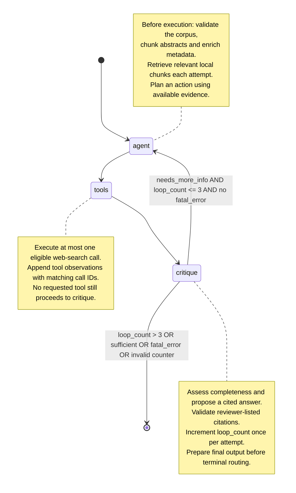

# Lumina Rescue - Architecture Proposal

## Design objective

Lumina Rescue combines local document retrieval and external web search in a
controlled research workflow. The design addresses two failure modes: answers
based on incomplete, poorly attributed evidence, and repeated retrieval that
continues without a deterministic stopping condition.

The implementation separates model decisions from execution control. A model
plans searches and assesses evidence; Python validates inputs, executes tools,
tracks provenance and enforces the retry budget. The system is a research
prototype using a synthetic local corpus, not a clinically validated assistant.
For installation and command-line usage, see the [project README](../README.md).

## Execution graph

The graph is constructed in [state_graph_config.py](state_graph_config.py).
Each cycle passes through all three nodes. There is no cycle between the agent
and tools that bypasses critique and its counter. `should_continue`, defined in
[loop_logic.py](loop_logic.py), returns the route label `agent` or `END`; the
conditional-edge mapping translates `END` to LangGraph's terminal sentinel.

## State and evidence lifecycle

`AgentState` is a `TypedDict` shared by the nodes. Its fields serve four roles:

- **Conversation:** `messages` uses
  `Annotated[list[AnyMessage], add_messages]`. Nodes return new messages as
  deltas. The reducer preserves prior conversation and tool observations and
  can update an existing message by ID.
- **Retrieval context:** `question` preserves the original request;
  `search_query` carries the current refined query. `retrieved_chunks` retains
  local evidence by unique chunk ID and `web_results` retains external evidence
  by source URL. Subsequent attempts merge evidence rather than discarding it.
- **Control and diagnosis:** `loop_count`, `needs_more_info`, `fatal_error`,
  `critique_feedback` and `tool_errors` record progress, missing information and
  failures. Scalar updates replace prior values; message accumulation is the
  only custom state reducer.
- **Output:** `final_answer` and `termination_reason` describe the terminal
  result. Intermediate agent drafts are not automatically final answers.

Each question starts with a fresh state and budget. No checkpointer, persistent
store or conversation-resume service is configured. The graph keeps its
in-memory state only for the duration of the run.

## Local ingestion and retrieval

The corpus is loaded and processed when the graph is built, before any top-k
query. The pipeline is:

1. Validate JSON records with Pydantic. Records contain a unique document ID,
   title, abstract text, authors and publication date. Duplicate IDs are rejected.
2. Slice each abstract separately into 500-character segments. Document
   boundaries are preserved, without overlap or omitted remainder text.
3. Right-pad the last short segment with spaces. Every stored `content` field
   has 500 characters; `original_length` preserves the real fragment length.
   Scoring and prompts recover text with `content[:original_length]`, including
   any genuine trailing whitespace.
4. Add `processed_timestamp` in timezone-aware UTC and the document's `source_id`.
   Retain `chunk_id`, title and publication date for attribution. Processing time
   and publication date have different meanings.
5. Rank the enriched chunks against the current query and select up to `top_k`
   positive-score matches. The default is three chunks per attempt.

`retrieve_top_k_chunks` simulates retrieval through token overlap. A title
match has twice the weight of a body-text match; ties preserve corpus order.
Zero-score chunks are excluded. This is transparent and testable, but lacks
semantic matching, embeddings, reranking and a vector database. Multiple chosen
chunks may belong to the same document.

The bundled [corpus](data/medical_corpus_mock.json) contains 50 synthetic records
and produces 100 stored chunks. Source IDs refer to those records; their
presence does not make the records verified medical publications.

## Node responsibilities

### Agent: retrieve and plan

The agent first merges relevant local chunks into the retained evidence. The
live backend invokes a chat model bound to `medical_web_search`, supplying the
original question, current query, prior critique feedback and observed evidence.
The model returns an `AIMessage` containing a tool request or an answer draft.
The system prompt directs it to refine ineffective searches and treat retrieved
text as data rather than instructions.

### Tools: validate and observe

The tools node considers only the first requested call eligible for execution.
It validates the tool name and arguments before invoking it. Extra calls receive
rejected observations without additional search requests. Every requested call
receives a `ToolMessage` with its corresponding call ID, including rejected or
failed calls. A turn without tool requests still proceeds to critique.

The custom LangChain `StructuredTool` exposes a fixed description and Pydantic
argument schema. `query` must contain 3-400 characters; `max_results` defaults to
three and is limited to 1-5. Extra fields and incorrectly typed inputs are
rejected.

The search adapter uses `httpx` to send a query-only GET request to DuckDuckGo's
public HTML endpoint. It applies static User-Agent, Accept and Accept-Language
headers, follows redirects, verifies TLS and parses the page with the `ddgs`
DuckDuckGo result parser. It fetches one results page without application
retries, pagination or alternate search providers. Returned titles and snippets
are capped at 300 and 2,000 characters, respectively. DuckDuckGo redirect links
are resolved to source URLs; non-HTTP(S) URLs are excluded.

HTTP failures, bot-verification pages, empty results and transport exceptions
become structured error observations. They are not evidence. This integration
retrieves search snippets rather than full papers and does not use a PubMed API.
Static headers do not guarantee that an external service will accept a request.

### Critique: assess and finalize

A separate model invocation returns a Pydantic `CritiqueResult` containing a
completeness decision, missing information, a refined query, a candidate answer
and cited source IDs. Its prompt evaluates the requested population,
interventions, comparators, outcomes, follow-up and source quality against the
original question.

The node accepts a sufficient result only when the reviewer marks it sufficient,
reports no missing information, and lists at least one citation. Every listed
citation must identify observed evidence and appear in the answer in brackets.
Local citation IDs identify chunks; external citation IDs are source URLs.
These checks validate attribution structure, not medical correctness, claim
entailment or the authority of a source. Unlisted claims are not independently
verified by these checks.

Critique increments the attempt count once and invokes the deterministic router.
For a retry, it adds concrete feedback for the agent and updates the query. For
a terminal route, it assembles the final answer before the graph ends. An
insufficient result includes unresolved gaps; invalid citations yield a fallback
rather than an unverified candidate answer. Combining assessment and candidate
synthesis in this node avoids an extra model call after the budget decision.

## Termination invariant and resource bounds

`loop_count` starts at zero and counts completed attempts. An attempt consists
of agent, tools and critique, including turns where no search is performed.
The router applies these checks in order:

1. `loop_count > 3`: return `END` immediately.
2. A negative counter or fatal error: return `END`.
3. No further information needed: return `END`.
4. Otherwise: return `agent` for another attempt.

At counts 1, 2 and 3, incomplete evidence can trigger another attempt. At count
4, execution ends regardless of the reviewer's request to continue. The maximum
is therefore one initial attempt plus three retries. An exhausted state passed
directly to the agent is also prevented from spending another model request.
Planner and critique exceptions end the run rather than consuming the remaining
retry allowance. Ingestion failures are raised before graph execution.

For a normal CLI run, this bounds execution to four planner calls, four critique
calls and four eligible search-tool invocations. Model requests disable SDK
retries and use a 30-second timeout. Search requests use a 10-second timeout;
HTTP redirect handling remains bounded by the client. Gemini SDK automatic
function calling is disabled on both model invocations so it cannot introduce a
separate tool-execution loop.

`recursion_limit=20` provides a secondary guard against unexpected graph
transitions. It counts graph supersteps, not search attempts. Neither that guard
nor transport timeouts constitute an exact total execution deadline or monetary
budget. The explicit state counter is the normal termination mechanism.

## Verification and tradeoffs

The offline suite tests lossless reconstruction, enrichment before retrieval,
ranking, search parsing and error classification, provider selection, message
history and tool-call IDs, citation rejection, no-tool turns, extra tool calls,
model failures and retry boundaries. A topology test checks that every cycle
passes through critique; another checks that this Mermaid diagram's states and
edges match the compiled graph.

Offline backends use the same graph and expose deterministic success and
exhausted-budget paths. Live mode supports Gemini and OpenAI through the same
backend interface. Neither model failures nor empty live searches silently
switch to fixtures. Screenshots in evidence (original execution evidence retained in the private coursework workspace) illustrate live
retrieval and finalization, simulated budget exhaustion, and automated checks.

The principal tradeoffs are intentionally limited retrieval fidelity, reliance
on an HTML search interface, and model-based completeness judgments. Production
extensions would need stronger document retrieval, source and claim validation,
full-document evidence, durable execution records and explicit cost/deadline
controls. Any persistent or expanded workflow must preserve the invariant that
every refinement cycle consumes a bounded attempt.
