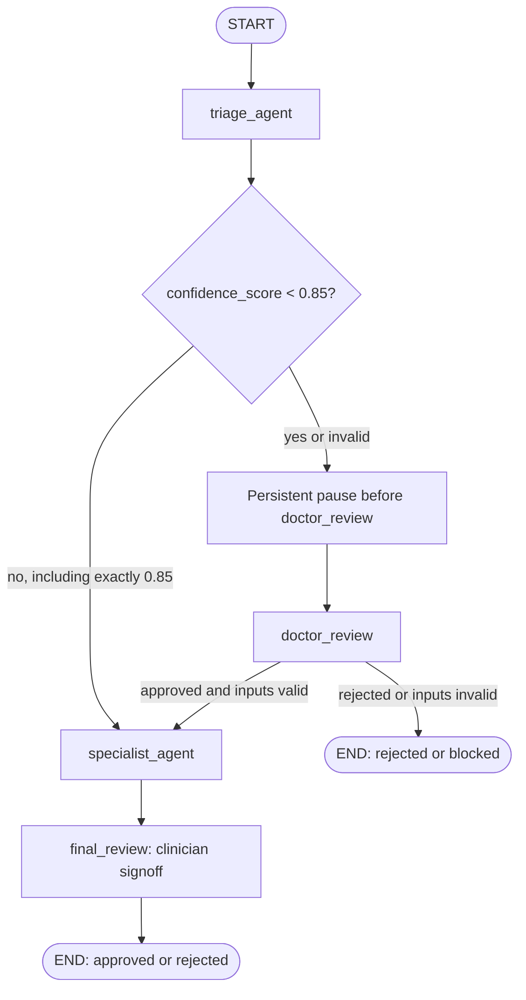

# AegisHealth — Medical Triage Architecture Handover

16 November 2026 | Executable blueprint using synthetic patient records.

## 1. Submission and responsibilities

The submission contains exactly the requested six files:

```text
triage_project/
├── architecture_handover.md
├── src/
│   ├── triage_workflow.py
│   ├── mcp_server.py
│   └── mock_patients.json
├── schemas/
│   └── a2a_schema.json
└── requirements.txt
```

`triage_workflow.py` includes the state contracts, assessment adapters, MCP client,
graph, authenticated review service, and CLI. `mcp_server.py` independently owns
tool execution, repository access, input/result schemas, and service authorization.
The workflow fetches records through MCP HTTP; it never imports the server's tool
or reads the patient JSON file directly. The A2A schema remains an external contract.

## 2. Workflow and human oversight



The three required nodes are present. Conditional edges apply the exact threshold:
0.80 escalates; 0.85 routes directly to the specialist. Invalid confidence values
fail closed. The compiler uses a persistent `AsyncSqliteSaver` and
`interrupt_before=["doctor_review"]`. Reusing `configurable.thread_id` restores the
same encounter after a restart; a new thread starts a separate encounter.

The additional `final_review` node resolves the brief's universal-oversight policy:
every specialist draft needs final clinician signoff, including high-confidence
cases. Low-confidence cases need both escalation approval and final draft approval.
The specialist currently validates and acknowledges a handoff; it does not diagnose.

`WorkflowService` verifies the local reviewer identity and hidden credential,
rejects stale checkpoint IDs, and signs decisions against the thread, phase,
checkpoint, clinician, timestamp and exact case digest. It rechecks the medical
record digest before approving valid cases. Changed records require reassessment.
A bare graph resume cannot approve a case: the doctor node falls back to a dynamic
interrupt unless it receives a verified decision. The final gate always uses
`interrupt()` and `Command(resume=signed_review)`. Confidence is retained after review.

## 3. State and A2A passing

`State` is a `TypedDict` with `messages: Annotated[list, add_messages]`. Nodes return
partial updates rather than mutating their inputs. New agent messages accumulate;
messages with the same ID can be updated, so this reducer is not a tamper-proof
append-only audit log. Pydantic and JSON Schema provide runtime boundary validation.

Intake owns `patient_id` and `symptoms`. Triage writes `confidence_score`,
`triage_priority`, `assessment_valid`, `records_status`, `records_digest`, and
`escalation_reason`. The review service supplies signed `doctor_review` decisions;
the doctor node can correct priority. The specialist writes `specialist_handoff`.
Final review writes `final_review`, `status`, and `released_payload`.
Only approved final review populates `released_payload`. Rejection ends the run;
failed records/model validation prevents specialist execution even after approval.
Historical records themselves are not persisted in graph state.

The sender serializes its handoff and the receiver validates it again against
`schemas/a2a_schema.json`. Required fields are `patient_id: string`,
`symptoms: string[]`, and `triage_priority: High | Medium | Low`.
`escalation_reason: string` is optional; additional fields are rejected. IDs follow
the mock convention `P-` plus four digits. This is the application's local messaging
contract, rather than a complete implementation of the external A2A standard.

```json
{
  "patient_id": "P-1001",
  "symptoms": ["Synthetic demonstration: headache"],
  "triage_priority": "Medium",
  "escalation_reason": "Confidence below 0.85"
}
```

## 4. External MCP service

`mcp_server.py` exposes async `get_medical_records(patient_id: str)` using the
official MCP SDK and JSON-RPC 2.0 over Streamable HTTP at
`http://127.0.0.1:8765/mcp/`. The SDK handles initialization, `tools/list`, and
`tools/call`. Input and result schemas are declared inline and advertised by the
tool, so no extra schema files are needed. Replace `JsonRecordsRepository` with
an async clinical data-service adapter to change the backing store.

The server checks a strong bearer service token and explicit patient ACL before
reading data, enforces Host/Origin checks, limits authenticated requests to 120
per minute, and sends `Cache-Control: no-store`. It binds only to loopback.
The client requires HTTPS remotely, disables redirects, validates response identity,
and makes at most two attempts, without retrying known permanent tool errors.
Repository reads have a 5-second timeout, client attempts 10 seconds, and triage
and pre-approval record validation 25 seconds.

Successful results contain ID, age, chronic conditions, and historical visits;
patient and physician names are excluded. Missing/invalid IDs return structured
tool errors with `isError: true`. Stable error kinds/codes are `INVALID_PARAMS`
(-32602), `UNKNOWN_TOOL` (-32601), `FORBIDDEN` (-32003), `NOT_FOUND` (-32004), and
`UNAVAILABLE` (-32001). Example `structuredContent`:

```json
{"error":{"code":-32602,"message":"A valid patient_id is required","data":{"kind":"INVALID_PARAMS"}}}
```

The SDK places that content inside a JSON-RPC result with the request's ID.
Malformed protocol messages instead use top-level JSON-RPC errors. Unauthenticated
HTTP calls receive 401, and rate-limited calls 429. Error responses omit raw patient
values, credentials, database paths, and upstream exception details.

## 5. Running locally

From `triage_project`, install dependencies into a Python environment:

```powershell
python -m pip install -r requirements.txt
```

Provide configuration through environment variables or a private `.env`.
The loader checks `TRIAGE_ENV_FILE` first, then `triage_project/.env` if present,
otherwise `../.local/.env`. Existing local credentials were preserved there during
cleanup; they are excluded from delivery. Required variables are:

- `MCP_RECORDS_TOKEN`: random service secret, at least 32 characters.
- `DOCTOR_REVIEW_TOKEN`: a distinct random clinician secret, at least 32 characters.
- `MCP_ALLOWED_PATIENT_IDS`: explicit comma-separated IDs, e.g. `P-1001,P-1002`.
- `DOCTOR_REVIEWERS`: comma-separated reviewer IDs, e.g. `doctor-local`.
- `MCP_SERVER_URL`: defaults to `http://127.0.0.1:8765/mcp/`.
- Optional live adapter: `GOOGLE_API_KEY` and `GEMINI_MODEL`.

Generate each local secret separately using `python -c "import secrets; print(secrets.token_urlsafe(32))"`
and save it privately. Never include the completed `.env` in a submission.

Start MCP in terminal 1:

```powershell
python -B -m src.mcp_server
```

In terminal 2, start and inspect a case:

```powershell
python -B -m src.triage_workflow start --thread-id encounter-01 --confidence 0.80
python -B -m src.triage_workflow status --thread-id encounter-01
python -B -m src.triage_workflow review --thread-id encounter-01 --checkpoint-id CHECKPOINT_FROM_STATUS --reviewer doctor-local
```

Review prompts for the hidden doctor credential, shows the case and history, then
asks for `approved`/`rejected`, a priority, and a note. For a low-confidence case,
repeat with the new checkpoint ID for final review. Never reuse an old checkpoint.
`demo --simulate-doctor` explicitly simulates decisions and is restricted to the
fixture backend. Live mode uses `start --backend gemini --synthetic-data` and cannot
auto-approve. Gemini receives minimized synthetic context without the patient ID;
its JSON result is independently validated.

Checkpoints default to `../.local/runtime/triage.sqlite`, outside the submission
tree. Override with `--db` or `TRIAGE_RUNTIME_DIR`. Existing approved/rejected
demonstration threads remain available after cleanup. `-B` prevents bytecode cache
files from appearing in the submitted source directory.

## 6. Communication traces and verification

Actual synthetic walkthrough trace (timestamps omitted):

```text
event=transition trace=4b0992f57d0d from=triage_agent to=doctor_review confidence=0.8
event=transition trace=4b0992f57d0d from=doctor_review to=specialist_agent status=escalation_approved
event=transition trace=4b0992f57d0d from=specialist_agent to=final_review
event=transition trace=4b0992f57d0d from=final_review to=END status=approved
```

Hashed thread references correlate transitions without logging patient details,
history, notes, or secrets. Interrupted nodes restart, so a pause-entry log may
appear twice. External LangSmith payload tracing is disabled by the CLI and refused
by the library when explicitly enabled. Human case inspection is separate from logs.

All 51 existing automated tests passed after source consolidation. Real MCP HTTP,
ACL checks, both threshold paths, and cross-process persistence were reverified.
The earlier live Gemini synthetic check returned 0.95 and remained pending human
review. The single delivery ZIP includes nine original screenshots in an `evidence/`
folder alongside the required `triage_project/` tree.
Local test tooling is retained outside the submission under `../.local/development`.

## 7. Deployment limitations

This is a synthetic orchestration blueprint, not a clinically validated triage
service. LLM confidence is not calibrated diagnostic accuracy. Replace shared local
credentials with individual organizational identity, revocation, patient-scoped
authorization, and protected signing keys. The process, configuration, and database
are trusted; do not expose raw graph invocation or state-update methods.

SQLite and in-process locks assume a single trusted writer. Multi-worker deployment
needs transactional review submission, distributed locking/compare-and-swap,
production checkpoint storage, and idempotency keys for any clinical side effects.
Add encrypted storage/backups, protected audit records, retention rules, TLS,
request-size limits, monitoring, review SLAs, and an independent urgent-care pathway.
Pending cases currently wait indefinitely; there is no background clinical paging
service. Revalidate pinned dependencies and clinical policies before real deployment.
